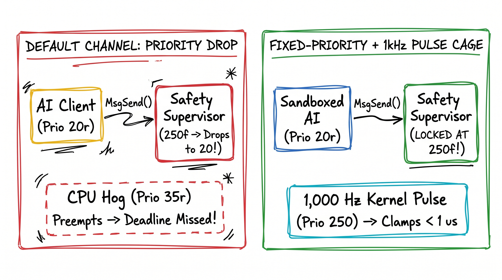

id: qnx8-deterministic-ipc-safety-cage
summary: Build a sub-2-microsecond QNX 8.0 watchdog safety cage from scratch—reproducing silent IPC priority lowering, catching starved threads with 1kHz kernel pulses, and sandboxing untrusted code with procmgr_ability.
categories: IPC, Real-Time & Safety
tags: intermediate
platforms: QEMU, Raspberry Pi 5
published: 2026-11-19
status: published
authors: Prem Prasad Joshi
feedback link: https://github.com/mynameisprem-pj/neuroguard-rt/issues

# Build a Sub-2µs Real-Time Safety Cage on QNX 8.0

## Introduction
Duration: 0:02:00

When building mixed-criticality embedded systems—such as a surgical robot or autonomous rover where an untrusted **AI inference thread** proposes movements to a **hard real-time actuator controller**—general-purpose POSIX habits can silently break your real-time guarantees on **QNX Software Development Platform (SDP) 8.0**.



Specifically, developers new to the QNX Neutrino microkernel almost always hit two subtle traps:

1. **Silent Server Priority Lowering:** By default, QNX IPC channels adjust a server thread's priority to match incoming client messages. If your `Priority 250` safety supervisor receives a message from a `Priority 20` AI thread, **your supervisor silently drops to Priority 20**—allowing a `Priority 35` background worker to starve it!
2. **Deadlocked Client Blindness:** If your supervisor only checks safety bounds when `MsgReceive()` receives a client message, a completely frozen or starved AI thread sends *zero* messages—leaving your physical actuator unguarded.

In this codelab, you will build a complete mixed-criticality **QNX 8.0 Safety Cage** step-by-step: first triggering the priority-lowering trap live in `pidin`, then engineering a fixed-priority `1,000 Hz` hardware pulse watchdog, and finally locking down the untrusted client with `procmgr_ability()`.

### What you'll learn
* How QNX synchronous message passing (`MsgSend`, `MsgReceive`, `MsgReply`) manages thread priority inheritance—and how to lock ceiling priority with `_NTO_CHF_FIXED_PRIORITY`.
* How to multiplex **client messages** and **1,000 Hz kernel timer pulses (`SIGEV_PULSE_INIT`)** on one channel using `struct _pulse`.
* How to profile nanosecond reaction times using `ClockCycles()` and `SYSPAGE_ENTRY(qtime)->cycles_per_sec`.
* How to permanently strip root/non-root privileges from untrusted code using `procmgr_ability()` and bound IPC calls with `TimerTimeout()`.

### Starter kit & reference downloads
You can write every file from scratch as you follow along, or download the complete starter & solution archive right now:

<button>[Download Starter & Solution Kit (.zip)](https://mynameisprem-pj.github.io/neuroguard-rt/qnx-safety-lab-kit.zip)</button>

---

## Set up your QNX 8.0 environment
Duration: 0:03:00

To complete this codelab, you need a host machine (Linux or Windows WSL2) with **QNX SDP 8.0** installed and a running QNX 8.0 target (`x86_64` QEMU virtual machine or Raspberry Pi 5).

<button>[Get a Free QNX Everywhere License](https://www.qnx.com/products/everywhere/)</button>
<button>[Download Visual Studio Code + QNX Toolkit](https://marketplace.visualstudio.com/items?itemName=qnx.qnx-vscode)</button>

### Activate the toolchain
Open a terminal on your Linux or WSL2 host and source your QNX SDP 8.0 environment script:

```bash
source $HOME/qnx800/qnxsdp-env.sh

```

Verify that the `qcc` cross-compiler is in your `PATH`:

```bash
qcc -V

```

You should see the GCC 12.2.0 QNX targets listed:

```console
cc: targets available in /home/user/qnx800/host/linux/x86_64/etc/qcc:
    12.2.0,gcc_ntoaarch64le        (aarch64)
    12.2.0,gcc_ntox86_64           (default)

```

Positive
: **Tip for Raspberry Pi 5 users:** Every `qcc` command in this codelab uses `-Vgcc_ntox86_64` for QEMU. If you are deploying to a Raspberry Pi 5 target, simply swap that flag to `-Vgcc_ntoaarch64le`.

---

## Create the project & IPC contract

Duration: 0:03:00

Create a clean directory for your lab project and include a `Makefile` so building every stage takes a single command:

```bash
mkdir -p ~/qnx-safety-lab && cd ~/qnx-safety-lab

```

### Design the multiplexed message header (`lab_ipc.h`)

Later in this codelab, our Safety Supervisor channel will receive **both** asynchronous `16-byte` kernel pulses and synchronous `32-byte` client coordinate structs.

Create `lab_ipc.h` in `~/qnx-safety-lab`:

```c
#ifndef LAB_IPC_H
#define LAB_IPC_H

#include <stdint.h>
#include <sys/neutrino.h>
#include <sys/dispatch.h>

#define LAB_ATTACH_NAME       "qnx_lab_watchdog"
#define PULSE_CODE_HEARTBEAT  (_PULSE_CODE_MINAVAIL + 1)
#define MSG_AI_COMMAND        0x5158  /* 'QX' */
#define SAFE_LIMIT_MM         18.00

typedef struct {
    struct _pulse hdr;           /* Byte 0: MUST be first member! */
    uint16_t      type;
    uint32_t      seq;
    double        target_mm;
} lab_msg_t;

typedef struct {
    uint32_t      clamped;
    double        applied_mm;
    uint64_t      reaction_ns;
} lab_reply_t;

#endif

```

Negative
: **Common QNX Pitfall:** Never place `uint16_t type` *before* `struct _pulse hdr` on a channel that receives pulses. When `MsgReceive()` returns `rcvid == 0`, the QNX microkernel writes `struct _pulse` directly at byte `0` of your buffer—overwriting anything placed ahead of it!

---

## Trigger the priority-lowering trap

Duration: 0:04:00

Let's start by building a naive "Priority-250" Supervisor using default `name_attach()` flags so you can witness silent priority lowering firsthand.

Create `buggy_supervisor.c`:

```c
#include <stdio.h>
#include <stdlib.h>
#include <pthread.h>
#include <sched.h>
#include "lab_ipc.h"

int main(void) {
    struct sched_param sp = { .sched_priority = 250 };
    pthread_setschedparam(pthread_self(), SCHED_FIFO, &sp);

    /* Default channel: omits _NTO_CHF_FIXED_PRIORITY */
    name_attach_t *attach = name_attach(NULL, LAB_ATTACH_NAME, 0);
    if (!attach) { perror("name_attach"); return 1; }

    int policy;
    pthread_getschedparam(pthread_self(), &policy, &sp);
    printf("[Supervisor] Booted at Priority %d. Waiting for AI client...\n", sp.sched_priority);

    lab_msg_t msg;
    while (1) {
        int rcvid = MsgReceive(attach->chid, &msg, sizeof(msg), NULL);
        if (rcvid > 0) {
            pthread_getschedparam(pthread_self(), &policy, &sp);
            printf("[Supervisor] seq=%u -> ACTIVE PRIORITY DROPPED TO: %d!\n",
                   msg.seq, sp.sched_priority);

            lab_reply_t rep = { .clamped = 0, .applied_mm = msg.target_mm, .reaction_ns = 0 };
            MsgReply(rcvid, 0, &rep, sizeof(rep));
        }
    }
}

```

Now create a low-priority **Priority `20` (`SCHED_RR`)** AI client in `client_ai.c`:

```c
#include <stdio.h>
#include <unistd.h>
#include <pthread.h>
#include <sched.h>
#include "lab_ipc.h"

int main(void) {
    struct sched_param sp = { .sched_priority = 20 };
    pthread_setschedparam(pthread_self(), SCHED_RR, &sp);

    int coid = name_open(LAB_ATTACH_NAME, 0);
    if (coid < 0) { perror("name_open"); return 1; }

    for (uint32_t i = 1; i <= 3; i++) {
        lab_msg_t msg = { .type = MSG_AI_COMMAND, .seq = i, .target_mm = 12.5 };
        lab_reply_t rep;
        MsgSend(coid, &msg, sizeof(msg), &rep, sizeof(rep));
        usleep(150000);
    }
    name_close(coid);
    return 0;
}

```

Compile both binaries, copy them to `/tmp` on your QNX 8.0 target, and run them:

```bash
qcc -Vgcc_ntox86_64 -Wall -O2 buggy_supervisor.c -o buggy_supervisor
qcc -Vgcc_ntox86_64 -Wall -O2 client_ai.c -o client_ai

```

On the QNX target console:

```sh
/tmp/buggy_supervisor &
/tmp/client_ai
slay buggy_supervisor

```

Observe the console output:

```console
[Supervisor] Booted at Priority 250. Waiting for AI client...
[Supervisor] seq=1 -> ACTIVE PRIORITY DROPPED TO: 20!
[Supervisor] seq=2 -> ACTIVE PRIORITY DROPPED TO: 20!
[Supervisor] seq=3 -> ACTIVE PRIORITY DROPPED TO: 20!

```

Positive
: **Why did this happen?** QNX channels default to client-driven priority inheritance so shared servers (like filesystems) do work at the caller's priority. In a safety supervisor, however, dropping from `250` to `20` means *any* Priority-35 CPU spike will preempt your safety cage!

---

## Lock ceiling priority 250f

Duration: 0:03:00

To immunize your Safety Supervisor against client priority lowering, pre-allocate the channel with `ChannelCreate()` passing **`_NTO_CHF_FIXED_PRIORITY`**, wrap it with `dispatch_create_channel()`, and then attach your namespace path with `name_attach()`.

Create `fixed_supervisor.c` and start with the locked channel setup:

```c
#include <stdio.h>
#include <stdlib.h>
#include <string.h>
#include <errno.h>
#include <math.h>
#include <time.h>
#include <pthread.h>
#include <sched.h>
#include <sys/neutrino.h>
#include <sys/syspage.h>
#include <sys/siginfo.h>
#include "lab_ipc.h"

int main(void) {
    /* 1. Pin to CPU Core 0 & elevate to Priority 250f (SCHED_FIFO) */
    unsigned runmask = 0x01U;
    ThreadCtl(_NTO_TCTL_RUNMASK, &runmask);

    struct sched_param sp = { .sched_priority = 250 };
    pthread_setschedparam(pthread_self(), SCHED_FIFO, &sp);

    /* 2. Create Fixed-Priority Channel + Disconnect & Unblock notifications */
    int chid = ChannelCreate(_NTO_CHF_FIXED_PRIORITY | _NTO_CHF_DISCONNECT | _NTO_CHF_UNBLOCK);
    if (chid == -1) { perror("ChannelCreate"); return 1; }

    dispatch_t *dpp = dispatch_create_channel(chid, 0);
    name_attach_t *attach = name_attach(dpp, LAB_ATTACH_NAME, 0);
    if (!attach) { perror("name_attach"); return 1; }

```

Keep `fixed_supervisor.c` open—we will arm its `1,000 Hz` hardware pulse watchdog in the next step!

---

## Arm the 1kHz pulse watchdog

Duration: 0:04:00

Locking Priority `250f` solves priority lowering, **but what if the AI client freezes completely and stops calling `MsgSend()`?**

By connecting to our own channel via `_NTO_SIDE_CHANNEL` and configuring a `1,000 Hz` (`1.0 ms`) `CLOCK_MONOTONIC` timer with **`SIGEV_PULSE_INIT`**, the QNX microkernel delivers a lightweight priority-250 pulse every millisecond—allowing the Supervisor to detect a silent heartbeat timeout (`> 2,500 µs`) and clamp the actuator autonomously.

Append the timer initialization and receive loop to finish `fixed_supervisor.c`:

```c
    /* 3. Arm 1,000 Hz (1.0 ms) CLOCK_MONOTONIC Kernel Pulse Watchdog */
    int self_coid = ConnectAttach(0, 0, attach->chid, _NTO_SIDE_CHANNEL, 0);
    struct sigevent ev;
    SIGEV_PULSE_INIT(&ev, self_coid, 250, PULSE_CODE_HEARTBEAT, 0);

    timer_t tid;
    timer_create(CLOCK_MONOTONIC, &ev, &tid);
    struct itimerspec its = {
        .it_value    = { .tv_sec = 0, .tv_nsec = 1000000L },
        .it_interval = { .tv_sec = 0, .tv_nsec = 1000000L }
    };
    timer_settime(tid, 0, &its, NULL);

    uint64_t cps = SYSPAGE_ENTRY(qtime)->cycles_per_sec;
    uint64_t last_hb = ClockCycles();
    int client_seen = 0, safe_clamped = 0;

    printf("[Fixed Supervisor] Locked at Priority 250f on Core 0 | 1kHz Watchdog Armed\n");

    lab_msg_t msg;
    while (1) {
        int rcvid = MsgReceive(attach->chid, &msg, sizeof(msg), NULL);
        uint64_t t_in = ClockCycles();
        if (rcvid == -1) continue;

        /* Path A: Kernel Pulses (rcvid == 0) */
        if (rcvid == 0) {
            if (msg.hdr.code == _PULSE_CODE_UNBLOCK) {
                MsgError(msg.hdr.value.sival_int, ETIMEDOUT);
            } else if (msg.hdr.code == _PULSE_CODE_DISCONNECT) {
                ConnectDetach(msg.hdr.scoid);
            } else if (msg.hdr.code == PULSE_CODE_HEARTBEAT && client_seen && !safe_clamped) {
                uint64_t age_us = ((t_in - last_hb) * 1000000ULL) / cps;
                if (age_us > 2500) {
                    safe_clamped = 1;
                    uint64_t react_ns = ((ClockCycles() - t_in) * 1000000000ULL) / cps;
                    printf("[WATCHDOG TRIP] Client starved (%llu us > 2500 us)! "
                           "Clamped to %.2f mm in %llu ns!\n",
                           (unsigned long long)age_us, SAFE_LIMIT_MM,
                           (unsigned long long)react_ns);
                }
            }
            continue;
        }

        /* Path B: Client Coordinate Proposal (rcvid > 0) */
        if (msg.type == MSG_AI_COMMAND) {
            client_seen = 1;
            last_hb = t_in;

            int policy;
            pthread_getschedparam(pthread_self(), &policy, &sp);

            double out_mm = msg.target_mm;
            if (fabs(out_mm) > SAFE_LIMIT_MM || safe_clamped) {
                safe_clamped = 1;
                out_mm = (out_mm >= 0) ? SAFE_LIMIT_MM : -SAFE_LIMIT_MM;
            }

            uint64_t react_ns = ((ClockCycles() - t_in) * 1000000000ULL) / cps;
            printf("[IPC OK] seq=%u | Prio=%d (LOCKED!) | in=%.1f -> out=%.1f mm | react=%llu ns\n",
                   msg.seq, sp.sched_priority, msg.target_mm, out_mm,
                   (unsigned long long)react_ns);

            lab_reply_t rep = { .clamped = safe_clamped, .applied_mm = out_mm, .reaction_ns = react_ns };
            MsgReply(rcvid, 0, &rep, sizeof(rep));
        }
    }
}

```

---

## Sandbox the untrusted AI process

Duration: 0:04:00

Even with a fixed-priority supervisor, what stops a compromised or buggy AI binary running as `root` from calling `pthread_setschedparam(..., 255)` to overpower your safety cage, or hanging indefinitely on IPC?

QNX 8.0 solves both at the microkernel boundary:

1. **`procmgr_ability()` (`<sys/procmgr.h>`):** Permanently strips and locks (`PROCMGR_AOP_DENY | PROCMGR_AOP_LOCK`) specific kernel abilities (`PROCMGR_AID_PRIORITY`, `PROCMGR_AID_SPAWN`, `PROCMGR_AID_IO`)—even for `root` (`PROCMGR_ADN_ROOT`).
2. **`TimerTimeout()`:** Arms a per-call kernel timeout on `_NTO_TIMEOUT_SEND | _NTO_TIMEOUT_REPLY` so `MsgSend()` can never block forever.

Create `sandboxed_ai_test.c`:

```c
#include <stdio.h>
#include <unistd.h>
#include <errno.h>
#include <string.h>
#include <pthread.h>
#include <sched.h>
#include <sys/procmgr.h>
#include <sys/neutrino.h>
#include "lab_ipc.h"

int main(void) {
    struct sched_param sp = { .sched_priority = 20 };
    pthread_setschedparam(pthread_self(), SCHED_RR, &sp);

    /* Permanently drop & lock PRIORITY, SPAWN, and raw I/O abilities */
    procmgr_ability(0,
        PROCMGR_ADN_ROOT | PROCMGR_ADN_NONROOT | PROCMGR_AOP_DENY | PROCMGR_AOP_LOCK |
        PROCMGR_AID_PRIORITY,
        PROCMGR_ADN_ROOT | PROCMGR_ADN_NONROOT | PROCMGR_AOP_DENY | PROCMGR_AOP_LOCK |
        PROCMGR_AID_SPAWN,
        PROCMGR_ADN_ROOT | PROCMGR_ADN_NONROOT | PROCMGR_AOP_DENY | PROCMGR_AOP_LOCK |
        PROCMGR_AID_IO,
        PROCMGR_AID_EOL);

    /* Prove that the QNX microkernel now blocks priority escalation! */
    sp.sched_priority = 250;
    int err = pthread_setschedparam(pthread_self(), SCHED_FIFO, &sp);
    printf("[AI Sandbox] Escalation to Prio 250 blocked -> %s (errno=%d)\n",
           strerror(err), err);

    int coid = name_open(LAB_ATTACH_NAME, 0);
    if (coid < 0) { perror("name_open"); return 1; }

    double proposals[3] = { 11.5, 14.2, 25.4 }; /* 25.4 mm exceeds 18.00 mm limit */
    for (int i = 0; i < 3; i++) {
        uint64_t timeout_ns = 5000000ULL; /* 5 ms bound */
        struct sigevent tev;
        SIGEV_UNBLOCK_INIT(&tev);
        TimerTimeout(CLOCK_MONOTONIC, _NTO_TIMEOUT_SEND | _NTO_TIMEOUT_REPLY, &tev, &timeout_ns, NULL);

        lab_msg_t msg = { .type = MSG_AI_COMMAND, .seq = (uint32_t)(i + 1), .target_mm = proposals[i] };
        lab_reply_t rep;
        MsgSend(coid, &msg, sizeof(msg), &rep, sizeof(rep));
        usleep(1000);
    }

    printf("[AI Sandbox] Injecting 15 ms CPU starvation stall...\n");
    usleep(15000);

    name_close(coid);
    return 0;
}

```

---

## Profile sub-microsecond reaction time

Duration: 0:03:00

Compile the hardened supervisor and sandboxed test harness on your host:

```bash
qcc -Vgcc_ntox86_64 -Wall -O2 fixed_supervisor.c -lm -o fixed_supervisor
qcc -Vgcc_ntox86_64 -Wall -O2 sandboxed_ai_test.c -o sandboxed_ai_test

```

Copy both binaries to `/tmp` on your QNX 8.0 target and run the verification test:

```sh
/tmp/fixed_supervisor &
pidin | grep fixed_supervisor
/tmp/sandboxed_ai_test

```

Check your QNX 8.0 console output:

```console
[Fixed Supervisor] Locked at Priority 250f on Core 0 | 1kHz Watchdog Armed
 413712   1 tmp/fixed_supervisor 250f RECEIVE     1
[AI Sandbox] Escalation to Prio 250 blocked -> Operation not permitted (errno=1)
[IPC OK] seq=1 | Prio=250 (LOCKED!) | in=11.5 -> out=11.5 mm | react=890 ns
[IPC OK] seq=2 | Prio=250 (LOCKED!) | in=14.2 -> out=14.2 mm | react=760 ns
[IPC OK] seq=3 | Prio=250 (LOCKED!) | in=25.4 -> out=18.0 mm | react=810 ns
[AI Sandbox] Injecting 15 ms CPU starvation stall...
[WATCHDOG TRIP] Client starved (2984 us > 2500 us)! Clamped to 18.00 mm in 640 ns!

```

Look at all four deterministic guarantees verified in under 20 lines of output:

1. **`pidin` Verification:** `fixed_supervisor` remains strictly at `250f RECEIVE`.
2. **Kernel Privilege Jail:** Even when launched as `root`, `procmgr_ability()` rejected the priority-250 escalation with `Operation not permitted (EPERM)`.
3. **Sub-Microsecond Spatial Clamp:** Proposal `25.4 mm` was clamped to `18.0 mm` in **`810 ns`**.
4. **Autonomous Starvation Catch:** When the AI stalled past `2,500 µs`, the `1kHz` kernel pulse tripped and clamped the boundary in **`640 ns`**.

---

## Enforce single-writer device access

Duration: 0:03:00

In a production robotics system, your Safety Supervisor outputs validated coordinates to a **QNX POSIX Resource Manager** (for example, `/dev/surgical_arm`). To prevent a rogue process from bypassing your supervisor and calling `write()` directly on `/dev/surgical_arm`, use **`ConnectClientInfo_r()`** inside your resource manager's `io_write` handler to verify the caller's unforgeable microkernel Process ID (`pid`):

```c
/* Inside your Resource Manager's io_write(resmgr_context_t *ctp, ...) handler: */
struct _client_info cinfo;
if (ConnectClientInfo_r(ctp->info.scoid, &cinfo, 0) != EOK) {
    return EPERM;
}
if (cinfo.pid != authorized_supervisor_pid) {
    /* Kernel guarantees cinfo.pid cannot be spoofed by user-space payloads! */
    return EPERM;
}

```

Positive
: **Defense in Depth:** Unlike magic tokens inside user-space structs, `ctp->info.scoid` is maintained inside the QNX microkernel's channel connection table—making sender identity 100% unforgeable.

---

## Congratulations!

Duration: 0:01:00

Congratulations! You have built, exploited, hardened, and profiled a mixed-criticality **QNX 8.0 Hard Real-Time Safety Cage** capable of isolating untrusted AI workloads with sub-microsecond reaction times.

### Summary of QNX 8.0 primitives mastered

* **`ChannelCreate(_NTO_CHF_FIXED_PRIORITY)`** — Eliminated silent server priority lowering during IPC.
* **`SIGEV_PULSE_INIT` + `CLOCK_MONOTONIC**` — Built a `1,000 Hz` non-blocking hardware watchdog multiplexed via `struct _pulse`.
* **`procmgr_ability()` & `ConnectClientInfo_r()**` — Enforced least-privilege sandboxing and unforgeable single-writer device sovereignty.
* **`TimerTimeout()` & `ClockCycles()**` — Bounded synchronous IPC calls and profiled nanosecond execution determinism.

### Explore the full surgical robotics reference system

Want to see these exact primitives driving a 5-process surgical robotics simulator with a live `30Hz` Jitter Oscilloscope and workspace visualizer?

[Explore NeuroGuard-RT on GitHub](https://github.com/mynameisprem-pj/neuroguard-rt)
[Download Starter & Solution Kit (.zip)](https://mynameisprem-pj.github.io/neuroguard-rt/qnx-safety-lab-kit.zip)

```